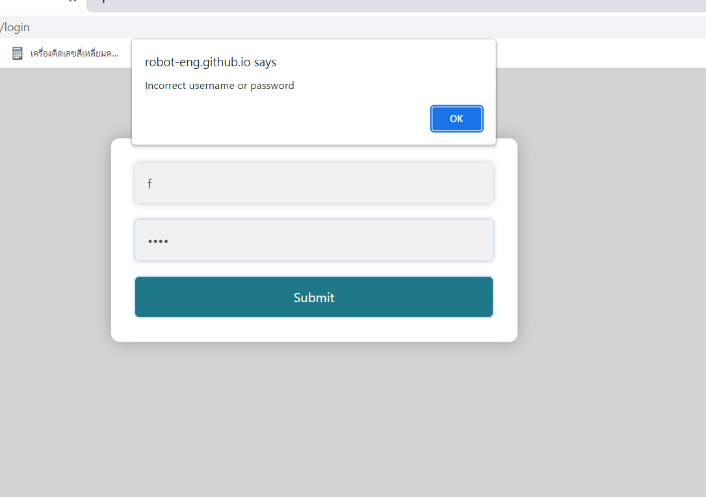

# Web Test GitHub Pages

A collection of English-learning apps, mini tools, and experiments deployed with GitHub Pages.

## Featured Projects

### Kham Khoi Jam

A Thai-English vocabulary notebook built with React, Vite, and Firebase Cloud Firestore.

- **Static GitHub Pages build:** [Kham Khoi Jam](https://robot-eng.github.io/web_test.github.io/kham-khoi-jam/site/)
- Firebase Cloud Firestore (`words` collection) stores vocabulary and spaced-repetition progress online in real time.
- `data/vocabulary.example.json` provides starter seed words if the Firebase database is new.
- `data/dictionary.json` contains curated offline entries.
- `data/lexitron-etlex.dat` provides offline English-to-Thai translations.
- WordNet supplies offline English definitions.

Thai readings are approximate transliterations generated from the CMU Pronouncing Dictionary (ARPABET), with curated overrides for common words.

### English Encyclopedia

A deep-dive resource for English learners covering everything from basic grammar to advanced speaking secrets.

- **Web App:** [Open Encyclopedia](https://robot-eng.github.io/web_test.github.io/oxforee/infor.html)
- **11 Essential Sections:**
  1. **Structure & Parts of Speech:** Basic and advanced classifications.
  2. **Tenses Cheat Sheet:** 12 tenses with timeline concepts.
  3. **Question Helper:** Question tags and sentence structures.
  4. **Modal Verbs:** Nuances of modals and past modals.
  5. **Comparison:** Higher-level comparative structures.
  6. **Prepositions:** Transport logic and confusing pairs.
  7. **Nouns & Quantifiers:** Articles and quantity words.
  8. **Contrastive Logic:** Common translation errors and logic gaps.
  9. **If-Clauses & Connectors:** Conditionals and logical connectors.
  10. **Advanced Grammar:** Gerunds, participles, and used to/be used to.
  11. **Speaking & Pronunciation:** Magic E, phonics, and casual speech.

### Oxford 3000+ Flashcards

- **Version 1:** [Oxford 3000+ v.1](https://word-eng.web.app/)
- **Version 2:** [Oxford 3000+ v.2](https://robot-eng.github.io/web_test.github.io/oxforee/index.html)

Key features include CEFR progress tracking, responsive UI, pronunciation with browser text-to-speech, and integrated grammar guides.

### Game

- [Werewolf App](https://robot-eng.github.io/web_test.github.io/werewolf-app/)

## Other Mini Tools

| Project | Live Demo |
| :--- | :--- |
| Logic Gate | [Logic Gate Media](https://robot-eng.github.io/web_test.github.io/tech_logic/index.html) |
| Battery App | [Check Battery Status](https://robot-eng.github.io/web_test.github.io/battery-app/index.html) |
| Calculator | [Minimalist Calculator](https://robot-eng.github.io/web_test.github.io/calculator.html) |
| Time App | [Digital Clock UI](https://robot-eng.github.io/web_test.github.io/time.html) |

## Screenshots

<p align="center">
  
  
  
</p>
<p align="center">
  
  
  
</p>

## Run Kham Khoi Jam Locally

```sh
npm install
npm run dev
```

Open http://127.0.0.1:5173. Node.js 20.19+ is required.

To rebuild the static Pages version, run:

```sh
npm run build:pages
```

This generates `public/pages-dictionary.json` from the bundled LEXiTRON and WordNet sources.

## Licenses And Data Notes

The LEXiTRON-derived source is copyrighted by NECTEC. This product is created by the adaptation of LEXiTRON developed by NECTEC (http://www.nectec.or.th/). LEXiTRON data does not provide English definitions or example sentences; WordNet supplies definitions, and the app uses an available WordNet phrase as an example when possible.

Related license files:

- `data/LEXITRON-LICENSE.txt`
- `data/LEXITRON-LICENSE-th.txt`
- `data/WORDNET-LICENSE.txt`
- `data/CMU-PRONOUNCING-LICENSE.txt`
- `kham-khoi-jam/data/LEXITRON-LICENSE.txt`
- `kham-khoi-jam/data/LEXITRON-LICENSE-th.txt`
- `kham-khoi-jam/data/WORDNET-LICENSE.txt`
- `kham-khoi-jam/data/CMU-PRONOUNCING-LICENSE.txt`

## Deployment

This repository is deployed automatically via GitHub Pages.
